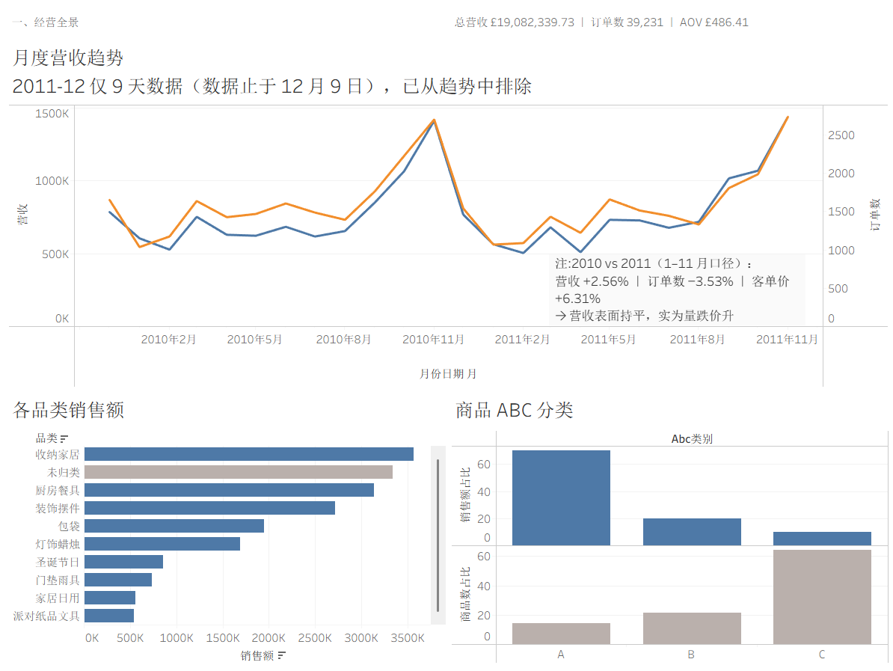
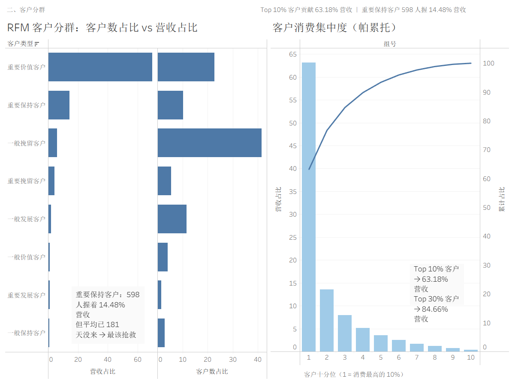
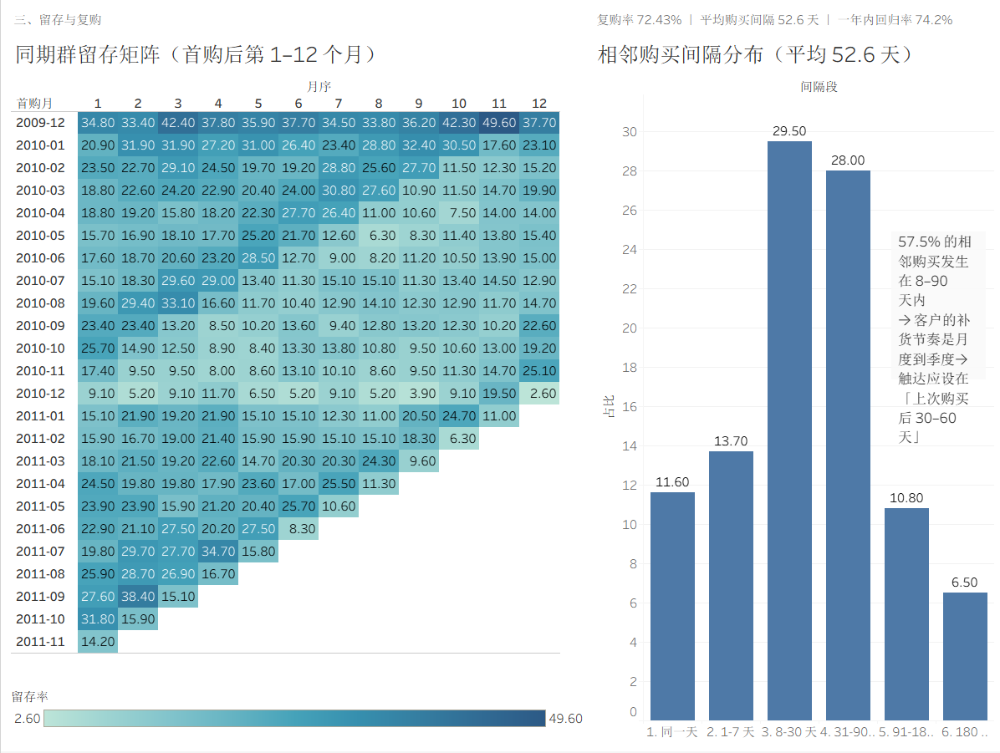

# 电商用户消费行为分析

基于 **MySQL + Excel + Tableau** 的零售交易数据清洗与多维分析项目：对一家英国在线礼品零售商 **106.7 万行**交易流水完成清洗、建模，并从**客户**与**商品**两个维度输出分析结论，最终交付一套可重跑的 SQL 流程与三屏交互式看板。


---

## 一、项目背景

数据集只有 8 个字段：发票号、商品编码、商品描述、数量、单价、发票时间、客户 ID、国家。**就是这么一张宽表，要回答三个层次的问题**：

> 1. **这门生意是怎么长的？** —— 两年的营收走势、有没有淡旺季、增长从哪来
> 2. **钱集中在谁身上？** —— 哪些客户值得投入、他们现在是什么状态
> 3. **卖什么最赚钱？** —— 哪些商品是库存负担、该砍哪些

**项目的重点不在于"把 SQL 跑通"，而在于两件事**：

- **清洗的可追溯性** —— 每一步删了什么、为什么删、删了多少，全程可复算
- **每个结论都写明口径** —— 本项目里同一个词，口径不同数字能差 25 倍（详见第五章）

---

## 二、数据说明

| 项 | 内容 |
| --- | --- |
| 数据集 | **Online Retail II**（UCI Machine Learning Repository）|
| 来源 | https://archive.ics.uci.edu/dataset/502/online+retail+ii |
| 业务背景 | 英国一家在线礼品 / 家居零售商 |
| 时间跨度 | 2009-12-01 07:45 ~ 2011-12-09 12:50（25 个月）|
| 原始规模 | **1,067,371 行 × 8 列**（约 91 MB）|
| 数据粒度 | **订单行明细** —— 一次下单买 3 种商品 = 1 张发票 = 3 行 |

**清洗后关键指标**（后续所有分析的对账基准）：

| 指标 | 值 |
| --- | --- |
| 有效行数 | **996,548**（保留率 93.4%）|
| **总营收** | **£19,082,339.73** |
| 订单数（= 独立发票数）| **39,231** |
| 客户数（实名）| **5,835** |
| AOV（平均订单金额）| £486.41 |
| 匿名订单 · 行 / 发票 / 营收 | 226,636（22.74%）/ 2,922（7.45%）/ £2,574,108.05（13.49%）|

> ⚠️ 原始数据约 91 MB，**不纳入版本库**，下载后重命名为 `data/online_retail_II.csv`。

---

## 三、目录结构

```
online-retail-data-analysis/
├── README.md
├── 数据质量记录.md                 # 全部数据质量发现（权威源，数字都在这里）
│
├── mysql/                        # 可重跑的 SQL 流程（数字前缀 = 执行顺序）
│   ├── 01_create_database.sql
│   ├── 02_create_raw_table.sql
│   ├── 03_load_data.sql          # LOAD DATA，含 ESCAPED BY ''
│   ├── 04_profiling.sql          # 数据探查（只读）
│   ├── 05_build_clean_table.sql  # 清洗漏斗 + 构建清洗层
│   ├── 06_add_derived_fields.sql # 派生字段（生成列）
│   ├── 07_analysis_overview.sql  # 经营概览
│   ├── 08_pareto.sql             # 帕累托分析
│   ├── 09_monthly_trend.sql      # 月度趋势 + 季节性
│   ├── 10_rfm.sql                # RFM 客户分群
│   ├── 11_retention_cohort.sql   # 留存 / 同期群
│   ├── 12_product_abc.sql        # 商品 ABC + 品类结构
│   └── 13_export_results.sql     # 导出 10 个结果集
│
├── data/
│   ├── online_retail_II.csv      # 原始数据 91MB（不入库）
│   ├── sample_100k.csv           # 10 万行抽样（Python 生成，固定随机种子）
│   ├── 数据字典.xlsx              # 8 字段 × 9 列字段级文档
│   └── exports/                  # 10 个分析结果集（供 Tableau / Excel）
│
├── EXCEL/
│   ├── 抽样数据.xlsx              # Power Query 复现清洗规则（与 MySQL 对照）
│   └── D7_商品分析.xlsx           # 数据透视表 + 图表
│
└── tableau/
    ├── online_retail.twbx        # 三屏看板（已打包数据，可直接打开）
    ├── 屏1-经营全景.png
    ├── 屏2-客户分群.png
    └── 屏3-留存与复购.png
```

**分层约定**：`data/` 放数据、`mysql/` 放 SQL 流程、`EXCEL/` 与 `tableau/` 放对应工具的产物。

---

## 四、核心结论

### 屏 1 · 经营全景



**结论一：营收表面持平，实为「量跌价升」**

2010 全年 £9,201,381.60，2011 全年 £9,094,215.72，看起来几乎没变。

但**剔除不完整的 12 月**后做同比（数据止于 2011-12-09，12 月只有 9 天）：

| 1–11 月 | 订单数 | 营收 | 客单价 |
| --- | --- | --- | --- |
| 2010 | 17,928 | £8,433,001.86 | £470.38 |
| 2011 | 17,296 | £8,649,244.30 | £500.07 |
| **同比** | **−3.53%** | **+2.56%** | **+6.31%** |

> **订单量在持续流失，是靠客单价上涨抵消掉的。** 只看总营收这一个数字会以为业务很稳 —— 实际上这是需要预警的信号，不是稳定的信号。

**结论二：9–11 月是稳定旺季，11 月为峰值**

各月平均营收：**11 月 £1,427,363（峰值）**、10 月 £1,068,361、9 月 £935,376；低谷是 2 月 £516,433。

2010 与 2011 两年的规律完全一致（2010-11 £1,413,694 / 2011-11 £1,441,033），说明这是**业务的固有季节性**，可直接用于指导备货与排班。

**结论三：14% 的商品贡献 70% 的销售额**

| ABC 类别 | 商品数 | 商品数占比 | 销售额占比 | 平均单品销售额 |
| --- | --- | --- | --- | --- |
| **A** | 674 | 14.34% | **69.99%** | £19,816 |
| B | 1,015 | 21.60% | 20.00% | £3,761 |
| C | 3,010 | 64.06% | **10.00%** | £634 |

> **C 类那 3,010 个商品是库存负担** —— 平均单品销售额只有 A 类的 1/31。它们不该有同等的库存深度与采购频次，真正该做的是**对 C 类做减法**。

---

### 屏 2 · 客户分群



**结论四：Top 10% 客户贡献 63.18% 营收**

| 客户分位 | 客户数 | 营收占比 |
| --- | --- | --- |
| **Top 10%** | 584 | **63.18%** |
| Top 30% | 1,752 | 84.66% |
| Top 50% | 2,917 | 93.40% |
| 最低 50% | 2,918 | **6.60%** |

**而且集中是「高频复购」驱动的，不是几笔运气大单** —— Top 10 客户中多位购买次数超过 100 次（最高 **370 次**），说明高营收来自长期稳定的重复采购。

> 所以运营资源不应平均分摊到全部客户；抓头部的手段是**维护长期供应关系**，而不是促销冲大单。
>
> 但**集中度是双刃剑** —— 63% 的营收压在 10% 的客户身上，意味着这批人一旦流失，营收会直接蒸发六成。「维护头部」的本质是**风险管理**，不只是增长策略。

**结论五：最该抢救的不是「重要价值客户」，而是「重要保持客户」**

| 客户类型 | 客户数 | 客户占比 | 营收占比 | 平均R | 平均F | 平均M |
| --- | --- | --- | --- | --- | --- | --- |
| 重要价值客户 | 1,330 | 22.79% | **69.76%** | 19 天 | 16.4 | £8,659 |
| **重要保持客户** | 598 | 10.25% | **14.48%** | **181 天** | 9.5 | £3,999 |
| 一般挽留客户 | 2,421 | 41.49% | 6.09% | 364 天 | 1.7 | £415 |

> 重要价值客户**正在活跃**（19 天前来过），动作是「保」；而 598 个重要保持客户**买过 9.5 次、花过 £3,999** —— 说明流失不是"没兴趣"，而是已经 **181 天没来了**。他们握着 14.48% 的营收且正在流失中，**这才是最该投入的抢救对象**。

---

### 屏 3 · 留存与复购



**结论六：客户会回来，但回来得慢**

| 指标 | 值 | 回答的问题 |
| --- | --- | --- |
| **月度留存率**（M1–M12）| 稳定在 **19.4% – 25.0%** | 客户**多久来一次** |
| **累积回归率**（一年内）| **74.2%** | 客户**还回不回来** |
| 复购率 | 72.43% | |
| 平均购买间隔 | **52.6 天** | |

> 两个数不矛盾：一个客户可能 1 月来、3 月来、7 月来，贡献了 M1/M3/M7 的分子，但中间那些月份他是"没来"的。
>
> **所以客户不是流失了，而是回来得慢。** 运营动作不是"抢救流失客"，而是**把触达节奏匹配到客户 30–60 天的采购周期** —— 按月推送太密，等半年太晚。

---

## 五、关键数据处理点

**这是本项目的重点，也是面试中最常被追问的部分。**

### 1. 清洗漏斗 —— 顺序不可调整

| 步骤 | 规则 | 剩余行数 | 本步剔除 |
| --- | --- | --- | --- |
| 0 | 原始 | 1,067,371 | — |
| 1 | 剔取消订单（`Invoice LIKE 'C%'`）| 1,047,877 | 19,494 |
| 2 | 剔负数量（`Quantity < 0`）| 1,044,420 | 3,457 |
| 3 | 剔非正价格（`ROUND(Price,2) <= 0`）| 1,041,652 | 2,768 |
| 4 | 剔非商品行（`StockCode NOT REGEXP '^[0-9]{5}[A-Za-z]*$'`）| 1,036,876 | 4,776 |
| 5 | 去完全重复行 | 1,003,213 | 33,663 |
| 6 | **剔「被取消的原始订单行」** | **996,548** | 6,665 |

**为什么顺序不能换**：各类脏数据**互相重叠** —— 22,950 行负数量中有 19,493 行本身就是取消订单，已在步骤 1 被剔除。

> ⚠️ **因此各类脏数据的独立计数不能相加**（19,494 + 22,950 + 6,207 + 6,094 = **54,745 是虚高的**）。实际累计剔除 **70,823 行**（= 1,067,371 − 996,548）。

**三个必须讲清的清洗决策**：

| 决策 | 理由 |
| --- | --- |
| `Customer_ID` 为空的行**保留**（转 NULL）| 这些是有效销售记录，仅买家未知；剔除会**低估营收** |
| `Description` 的 `TRIM` 放在**去重之后** | 保留"去重基于文件里实际存的原始值"这一口径。**实测两种顺序结果相同**（见第六章）|
| 非商品行（邮费 / 银行手续费 / 平台佣金等）**全部剔除** | 它们是发票上的费用条目，不是商品，混入会污染品类与价格分析 |

---

### 2. 三例「静默数据损坏」—— 字段在进出系统时被改写

> **共同点：不报错、总量对得上、只有做字段级校验才能发现。**

| # | 环节 | 工具行为 | 被改坏 | 修法 |
| --- | --- | --- | --- | --- |
| 一 | **导入** | MySQL 默认把 `\` 当转义符，把 `PINK\ON STICK` 写成 `PINKON STICK` | 12 行 | 导入语句加 `ESCAPED BY ''` |
| 二 | **导出** | Workbench 导出 CSV 时不转义字段内部的 `"` | 约 230 行 | 改用 Python 按 RFC4180 重新生成 |
| 三 | **导出** | `INTO OUTFILE` 抄了导入的 `ESCAPED BY ''`，字段内的英寸符号 `"` 无法转义 | 2 个商品 | 导出改用 `ESCAPED BY '"'` |

**第三例尤其值得记**：**导入和导出的转义方向是相反的**。

```
导入：ESCAPED BY ''    → 防止反斜杠被吃掉
导出：ESCAPED BY '"'   → 让双引号按 RFC4180 双写
```

实测三种写法在导出时的输出：

| 写法 | 输出 | 判定 |
| --- | --- | --- |
| `ESCAPED BY ''` | `"RABBIT 8"","TEA,COFFEE"` | ❌ 引号提前闭合，字段错位 |
| 默认（反斜杠）| `"RABBIT 8\"","TEA,COFFEE"` | ⚠️ 不是 RFC4180 |
| **`ESCAPED BY '"'`** | `"RABBIT 8""","TEA,COFFEE"` | ✅ 标准双写 |

> 我在脚本注释里还专门写了"要和导入一样注意转义"，**然后抄错了方向** —— 说明"知道有坑"和"知道坑在哪边"是两件事。

---

### 3. 一个改变了所有基准的漏洞：被取消的订单仍在计营收

**发现方式**：做帕累托分析前排查极值 —— 「那个 £168,469.60 的单到底是什么？」

一查：**它 12 分钟后就被取消了。**

```
581483   纸艺挂件   +80,995 个   £168,469.60   ← 客户下单
C581484  纸艺挂件   -80,995 个   £168,469.60   ← 12 分钟后取消
```

一笔取消的订单在数据里是**两行**，一正一负本该相互抵消。但清洗规则是「删掉 `C` 开头的行」—— **删了负数行，留下了正数行**，等于把退款记录撕了、购买记录还留着。

**影响**：

| 项 | 数值 |
| --- | --- |
| 残留的被取消原始行 | **6,665 行** |
| 虚增营收 | **£560,336.29（占总营收 2.85%）** |
| 虚增客户数 | **17 人**（名下所有订单都被取消，**从未真正购买**）|

**危害不止是钱**：客户 `12346` 唯一的"大额订单"其实被取消了。不修的话，他会在 RFM 里被排进最高价值档 —— 一个从未买过东西的高价值客户。

**修复时的关键分叉**：不能简单「只要有取消就删」。

> 有客户在 1 月和 4 月**各买了一次同样的商品**，只在 4 月取消了 1 月那笔。
> 朴素 `DELETE ... JOIN` 会把 4 月那笔**真实销售**也删掉。

| 口径 | 删除行数 | 涉及金额 |
| --- | --- | --- |
| 朴素 JOIN（错）| 13,045 | £769,891.74 |
| **按条数配对（对）** | **6,665** | **£560,336.29** |
| 差 | 6,110 | £204,115.26 |

**正确口径**：每个组合下最多删 `min(原始行数, 取消行数)` 行，用 `ROW_NUMBER()` 编号后截取实现。

**三重验证**：① 用另一种算法（`Σ min(原始行数, 取消行数)`）复核，结果一致；② 检查可加性，实名营收 + 匿名营收 = 总营收；③ 另用 awk 独立扫源文件实现同一套规则，结果完全一致。

---

### 4. 匿名订单不是随机缺失

**「Customer_ID 缺失」看似是普通的字段缺失，实测发现它有系统性偏向。**

| | 匿名 | 实名 | 倍数 |
| --- | --- | --- | --- |
| 每张发票平均金额 | **£880.94** | £466.43 | 1.89× |
| 每张发票平均行数 | **77.6 行** | 21.2 行 | 3.66× |

而且匿名发票的规模分布是**双峰**的：一头是 986 张 1–5 行的小散单（占 33.7% 张数、0.93% 营收），一头是 791 张 100+ 行的批发大单（占 27.1% 张数、**77.1% 营收**）。

> **所以「匿名 = 大客户」的说法是错的 —— 匿名订单里混着两类完全不同的东西。**

**对分析的影响**：匿名缺失属于 **MAR（随机缺失）** 而非 MCAR（完全随机缺失）。含义是**缺失不是随机的，但它是有规律、可描述的**。因此：

- 基于实名客户的结论是**有偏样本**，报告里必须写明口径，不能外推为"全体客户"
- RFM / 留存分析必须 `WHERE Customer_ID IS NOT NULL`，且**分子分母都要过滤**

---

### 5. 口径陷阱：六个「看起来一样但差很多」的数字

**同一个词，口径不同，数字能差 25 倍 —— 而且两种算法都不会报错。**

| 指标 | 口径 A | 口径 B | 差多少 |
| --- | --- | --- | --- |
| **订单数** | 按**行**算 996,548 | 按**发票**算 **39,231** | **25 倍** |
| **客单价** | 除以订单数 £486.41（AOV）| 除以客户数 £2,829.17（ARPU）| **5.8 倍** |
| **匿名占比** | 按行 22.74% | 按发票 7.45% | 按营收 13.49% |
| **留存率** | 月度留存率 ≈23% | 累积回归率 74.2% | **3 倍** |
| **购买次数** | 发票次数 `F` | 活跃月数 | 差 140 人 |
| **打分 vs 原值** | `F`（真实次数）| `F分`（NTILE 档位）| 复购率差 7.57pp |

**最值得讲的两个**：

**① 订单数不是行数。** 本表是**订单行明细**，一次下单买 3 种商品 = 1 张发票 = 3 行。`COUNT(*)` 得到 99.6 万，那是"卖出了多少行商品"；订单数应该是 `COUNT(DISTINCT Invoice)` = 39,231。

**② 月度留存率 ≠ 累积回归率。** 月度留存率（≈23%）说的是"这一个月里有多少客户下单了"，**不是**"只剩 23% 的客户还活着"。同一客户会在多个月份重复出现，各月数值**不可相加**。

> 我在项目里实际犯过这个错 —— 曾把 23% 读成"77% 的客户买完就走"，而实际**74.2% 的客户一年内至少回来过一次**，两者**相差近 3 倍**。

**一条可复用的自查规则**：**任何占比加不到 100%，就是分子分母不同源的报警器。**

---

### 6. 商品 ABC 与品类分类的边界

**ABC 阈值（70% / 90%）是人为设定的。** 常见还有 80%/95% 等，换一个阈值 A 类商品数就会变。所以「Top X% 商品贡献 Y%」这类结论**必须连同阈值一起写出来**。

**商品标识只能用 `StockCode`。** 实测独立 `StockCode` 4,699 个、独立 `Description` 5,307 个 —— 描述比商品多 638 个，说明同一商品有多种描述写法，用描述分组会把一个商品拆成多个。

**品类是人工归纳的近似分类。** 数据集**没有品类字段**，描述首词不可靠（`WHITE` / `RED` / `SMALL` 都是形容词）、尾词也不可靠（`REGENCY CAKESTAND 3 TIER` 的尾词是 `TIER`）。因此用一组关键词 `CASE WHEN` 人工归纳出 10 个品类，**覆盖率 82.50%**。

> **引用品类结论时必须同时报告覆盖率。** 若省略「未归类」那一行（占 17.50%），读者会以为分类覆盖了全部 —— 而它其实是**第二高的类别**，里面完全可能藏着一个更大的类。

---

## 六、快速开始

### 1. 重建数据库（可完整复算）

```bash
# 将 online_retail_II.csv 放到 MySQL 的 secure-file-priv 目录
# （本机为 C:/ProgramData/MySQL/MySQL Server 8.0/Uploads/）

mysql -u root -p < mysql/01_create_database.sql
mysql -u root -p < mysql/02_create_raw_table.sql
mysql -u root -p < mysql/03_load_data.sql          # 导入 106 万行，约 5 秒
mysql -u root -p < mysql/04_profiling.sql
mysql -u root -p < mysql/05_build_clean_table.sql  # 清洗 → 996,548 行
mysql -u root -p < mysql/06_add_derived_fields.sql
```

### 2. 跑分析并导出结果集

```bash
mysql -u root -p < mysql/07_analysis_overview.sql
mysql -u root -p < mysql/08_pareto.sql
mysql -u root -p < mysql/09_monthly_trend.sql
mysql -u root -p < mysql/10_rfm.sql
mysql -u root -p < mysql/11_retention_cohort.sql
mysql -u root -p < mysql/12_product_abc.sql
mysql -u root -p < mysql/13_export_results.sql     # 导出到 Uploads/exports/
```

### 3. 打开看板

直接双击 `tableau/online_retail.twbx` —— **数据已打包在文件内，不依赖外部路径**。

---

## 七、技术栈

| 类别 | 内容 |
| --- | --- |
| 数据库 | MySQL 8.0（`LOAD DATA INFILE` / 生成列 / 窗口函数 / CTE / `ROW_NUMBER` / `NTILE` / 自连接）|
| Excel | Power Query（清洗规则跨工具复现）、数据透视表、图表 |
| 可视化 | Tableau Desktop（3 屏看板，含双轴、热力图、帕累托图）|
| 分析方法 | 帕累托分析、RFM 模型、同期群留存分析、ABC 分类 |
| 工程实践 | ELT 分层建模、清洗漏斗、跨工具一致性验证、结果集导出 |

---

## 八、说明与局限

1. **样本代表性**：数据来自英国**一家**礼品 / 家居类在线零售商，**不代表大型电商平台**的普遍情况。
2. **客户维度有偏**：22.74% 的订单行没有客户 ID，且**并非随机缺失**（匿名订单金额更大、篮子更宽）。所有基于实名客户的结论（RFM、留存）均已写明口径，**不能外推为"全体客户"**。
3. **时间范围**：仅覆盖 2009-12 ~ 2011-12，**不能外推到其他时期**。且**首末月不完整** —— 2011-12 只有 9 天，所有同比均已剔除 12 月。
4. **品类分类是近似**：用关键词人工归纳，覆盖率 82.50%，**未归类部分占 17.50% 营收**。
5. **本分析为描述性分析**，回答"发生了什么"，不涉及预测建模。项目中已明确指出**本分析回答不了的问题**（如"该不该投入拉新"—— 那需要获客成本与客户生命周期价值，本数据集不包含）。

---

## 九、附：本项目刻意不做的事

为保证结论密度，以下两点是**有意识跳过**的：

- **不做星型模型** —— 数据集本身是单张宽表，人为拆成事实表 + 维度表属于造复杂度。JOIN 能力通过**留存分析的自连接**自然体现（那是分析本身要求的）。
- **不做多轮重复交叉验证** —— 同一结论用三种工具各验一遍是用力过猛。保留**一次必要的对照**（Power Query 复现清洗规则），并把数据呈现统一交给 Tableau，Excel 只做数据处理。
